# Windows EC2 Deployment & Linux-to-Windows RDP Connection

[](https://aws.amazon.com/ec2/)
[](https://www.microsoft.com/windows-server)
[](https://ubuntu.com/)
[](https://remmina.org/)
[](LICENSE)

A production-grade, portfolio-ready cloud engineering project demonstrating how to provision a secure Microsoft Windows Server instance on Amazon Web Services (AWS EC2) and establish a cross-platform Remote Desktop Protocol (RDP) management session from an Ubuntu Linux environment using the Remmina remote desktop client.

---

## Table of Contents

- [Project Overview](#project-overview)
- [Project Objectives](#project-objectives)
- [Technologies & Tools](#technologies--tools)
- [System Architecture](#system-architecture)
- [Video Demonstration](#video-demonstration)
- [Step-by-Step Implementation](#step-by-step-implementation)
  - [1. AWS EC2 Instance Provisioning](#1-aws-ec2-instance-provisioning)
  - [2. Security Group Hardening](#2-security-group-hardening)
  - [3. Windows Administrator Password Decryption](#3-windows-administrator-password-decryption)
  - [4. Ubuntu Linux & Remmina Setup](#4-ubuntu-linux--remmina-setup)
  - [5. Establishing the RDP Session](#5-establishing-the-rdp-session)
- [Expected Results & Verification](#expected-results--verification)
- [Troubleshooting & Diagnostics](#troubleshooting--diagnostics)
- [Security Best Practices](#security-best-practices)
- [Learning Outcomes](#learning-outcomes)
- [Repository Structure](#repository-structure)
- [Teardown & Cleanup](#teardown--cleanup)
- [License](#license)

---

## Project Overview

In enterprise infrastructure environments, cloud systems engineers and DevOps practitioners frequently operate in heterogenous, multi-operating-system landscapes. Managing cloud-hosted Windows workloads from a Linux administration workstation is a common operational task.

This project documents the end-to-end lifecycle of deploying an **Amazon Elastic Compute Cloud (EC2)** instance running **Microsoft Windows Server**, configuring stateful perimeter firewall rules using **AWS Security Groups**, performing client-side cryptographic decryption of the local administrator credentials, and establishing a low-latency, encrypted **Remote Desktop Protocol (RDP)** connection from an **Ubuntu Linux** desktop environment using **Remmina**.

---

## Project Objectives

1. **Deploy Cloud Infrastructure**: Provision an on-demand, Free-Tier-eligible Windows Server EC2 virtual machine within an AWS Virtual Private Cloud (VPC).
2. **Implement Network Least Privilege**: Architect an AWS Security Group permitting inbound TCP port `3389` restricted strictly to the administrator's `/32` public IPv4 address, mitigating automated internet scanning threats.
3. **Master Asymmetric Credential Decryption**: Understand and execute the RSA cryptographic workflow used by AWS to generate and decrypt initial Windows Server administrative credentials.
4. **Configure Cross-Platform Client Tooling**: Install, configure, and optimize the Remmina client and FreeRDP plugin on Ubuntu Linux.
5. **Establish & Validate Remote Management**: Authenticate over an encrypted TLS channel, accept self-signed instance certificates, and verify active management session inside the Windows Server Desktop.

---

## Technologies & Tools

| Category | Technology | Purpose in Project |
|:---|:---|:---|
| **Cloud Provider** | [Amazon Web Services (AWS)](https://aws.amazon.com/) | Cloud infrastructure host and global compute platform |
| **Compute Service** | [Amazon EC2](https://aws.amazon.com/ec2/) | Elastic virtual server hosting the Windows Server OS |
| **Server OS** | [Microsoft Windows Server 2022 Base](https://www.microsoft.com/windows-server) | Cloud-hosted guest operating system |
| **Firewall / Security** | [AWS Security Groups](https://docs.aws.amazon.com/vpc/latest/userguide/VPC_SecurityGroups.html) | Stateful virtual firewall regulating ingress on TCP port `3389` |
| **Client OS** | [Ubuntu Linux](https://ubuntu.com/) (VM on macOS) | Local administrative workstation environment |
| **Host Machine** | Apple MacBook | Physical hardware host running the virtualization layer |
| **Remote Access Protocol**| [RDP (Remote Desktop Protocol)](https://learn.microsoft.com/en-us/troubleshoot/windows-server/remote/remote-desktop-protocol-overview) | Proprietary Microsoft protocol for graphical screen sharing (TCP 3389) |
| **Remote Client** | [Remmina](https://remmina.org/) + FreeRDP Plugin | High-performance open-source remote desktop client for POSIX systems |
| **Cryptography** | RSA 2048-bit Key Pair (`.pem`) | Asymmetric key pair used to decrypt instance administrator password |

---

## System Architecture

The following diagram illustrates the complete network communication path, highlighting perimeter isolation, protocol parameters, and component boundaries:

```mermaid
flowchart LR
    %% Architecture Diagram: Windows EC2 Deployment & Linux-to-Windows RDP Connection

    subgraph LOCAL_HOST["Local Workstation Environment"]
        MAC["Local MacBook<br/>(macOS Host)"]
        
        subgraph VM["Virtualization Layer"]
            UBUNTU["Ubuntu Linux Virtual Machine"]
            REMMINA["Remmina RDP Client<br/>(GUI Remote Desktop)"]
        end
    end

    subgraph WAN["Public Network"]
        INTERNET["Internet Gateway / Transit"]
    end

    subgraph AWS_CLOUD["Amazon Web Services (AWS Cloud)"]
        subgraph VPC["Virtual Private Cloud (VPC)"]
            subgraph SG["AWS Security Group (Firewall)"]
                RULES["Inbound Rule:<br/>Type: RDP<br/>Protocol: TCP<br/>Port: 3389<br/>Source: User Public IP /32"]
            end
            
            subgraph EC2["Amazon EC2 Instance"]
                WIN_SERVER["Windows Server OS<br/>(EC2 Instance)"]
                WIN_DESKTOP["Windows Server Desktop<br/>(RDP Service / Port 3389)"]
            end
        end
    end

    MAC -->|"Host Hypervisor"| UBUNTU
    UBUNTU -->|"Runs Application"| REMMINA
    REMMINA -->|"Encrypted RDP Traffic<br/>TCP Port 3389"| INTERNET
    INTERNET -->|"Inbound Traffic Check<br/>Must match User Public IP"| RULES
    RULES -->|"Allow Inbound TCP:3389"| WIN_SERVER
    WIN_SERVER -->|"Renders Session"| WIN_DESKTOP

    %% Styling
    classDef client fill:#e1f5fe,stroke:#0288d1,stroke-width:2px,color:#01579b;
    classDef transit fill:#fff3e0,stroke:#f57c00,stroke-width:2px,color:#e65100;
    classDef aws fill:#e8f5e9,stroke:#388e3c,stroke-width:2px,color:#1b5e20;
    classDef security fill:#ffebee,stroke:#d32f2f,stroke-width:2px,color:#b71c1c;

    class MAC,UBUNTU,REMMINA client;
    class INTERNET transit;
    class WIN_SERVER,WIN_DESKTOP aws;
    class RULES security;
```



> For an in-depth architectural breakdown and protocol deep dive, see [docs/architecture.md](docs/architecture.md).

---

## Video Demonstration

A complete step-by-step video walkthrough demonstrating the AWS instance provisioning, security group setup, password retrieval, Remmina configuration, and successful remote desktop connection is available on YouTube:

[](https://youtu.be/wtNYvoChs90)

**Direct Link:** [https://youtu.be/wtNYvoChs90](https://youtu.be/wtNYvoChs90)

---

## Step-by-Step Implementation

### 1. AWS EC2 Instance Provisioning
1. Navigate to the **AWS Management Console** $\rightarrow$ **EC2** $\rightarrow$ **Launch Instance**.
2. **Name**: `Windows-RDP-Lab-Server`.
3. **AMI**: Select **Microsoft Windows Server 2022 Base** (Free tier eligible).
4. **Instance Type**: `t2.micro` (or `t3.micro` depending on region eligibility).
5. **Key Pair**: Create or select an RSA key pair (`.pem` format). Download and preserve the file locally.

### 2. Security Group Hardening
Under **Network Settings**, create a designated Security Group enforcing strict ingress filtering:

| Rule Type | Protocol | Port | Source Type | Source CIDR | Justification |
|:---|:---|:---|:---|:---|:---|
| **RDP** | TCP | `3389` | **My IP** | `<YOUR_PUBLIC_IP>/32` | Blocks internet-wide scanning while permitting admin access |

> [!WARNING]
> Never set the source to `0.0.0.0/0` (Anywhere). Exposing RDP globally invites automated brute-force attacks and port scans within seconds.

### 3. Windows Administrator Password Decryption
Unlike Linux instances that leverage direct SSH key pairs, Windows EC2 instances employ a hybrid asymmetric decryption model:
1. During initial boot, the Windows `EC2Launch` service generates a complex 32-character random administrator password.
2. The password is encrypted with the instance's associated RSA public key and embedded in instance metadata.
3. In the EC2 Console, select the instance $\rightarrow$ **Connect** $\rightarrow$ **RDP client** $\rightarrow$ **Get password**.
4. Upload your private `.pem` key file; the browser performs local cryptographic decryption and displays the plaintext `Administrator` password.

### 4. Ubuntu Linux & Remmina Setup
On your Ubuntu Linux virtual machine or workstation, install the Remmina client and FreeRDP plugin:

```bash
# Update repository package database
sudo apt update

# Install Remmina and the FreeRDP protocol library
sudo apt install -y remmina remmina-plugin-rdp
```

### 5. Establishing the RDP Session
1. Launch Remmina from your terminal or desktop launcher:
   ```bash
   remmina &
   ```
2. Select **RDP** from the protocol dropdown.
3. Enter the **Public IPv4 address** of your Windows EC2 instance.
4. Input credentials:
   * **Username**: `Administrator`
   * **Password**: `<YOUR_DECRYPTED_PASSWORD>`
5. Accept the self-signed TLS certificate dialog when prompted.
6. The Windows Server desktop will initialize and load into your Remmina window.

> For full granular instructions, see the complete [docs/setup-guide.md](docs/setup-guide.md).

---

## Expected Results & Verification

When the configuration is successfully executed, the following results are observed:

1. **AWS Infrastructure**:
   * EC2 instance enters **Running** state with **2/2 status checks passed**.
   * Security Group shows single ingress rule on TCP 3389 restricted to `<LOCAL_IP>/32`.
2. **Network Handshake**:
   * Running `nc -zvw5 <PUBLIC_IP> 3389` on Ubuntu returns `Connection succeeded`.
3. **Graphical Session**:
   * Remmina opens an interactive remote desktop session displaying the **Windows Server Desktop**.
   * **Server Manager** loads automatically, verifying full administrative access.

*(Refer to [screenshots/README.md](screenshots/README.md) for screenshot templates and evidence submission guides).*

---

## Troubleshooting & Diagnostics

| Symptom | Probable Cause | Actionable Fix |
|:---|:---|:---|
| **Connection timed out** | Dynamic local IP changed or Security Group misconfigured | Run `curl -s https://ifconfig.me` and update Security Group source CIDR to `<CURRENT_IP>/32`. |
| **"Password not available yet"** | EC2 initialization in progress | Allow 3–5 minutes for Windows Sysprep and `EC2Launch` routines to conclude before requesting password. |
| **Remmina Authentication Failed** | Typo in username or whitespace in password | Verify username is capitalized (`Administrator`) and ensure no leading/trailing spaces exist in the pasted password. |
| **No RDP option in Remmina** | Missing plugin package | Execute `sudo apt install -y remmina-plugin-rdp` and relaunch Remmina. |

> For comprehensive failure recovery workflows, consult [docs/troubleshooting.md](docs/troubleshooting.md).

---

## Security Best Practices

This project adheres to enterprise security standards:

- **Perimeter Defense**: Administrative ports are restricted strictly to specific IP addresses (`/32`), eliminating automated external attacks.
- **Credential Hygiene**: Private keys (`.pem`) are stored locally with restricted permissions (`chmod 400`) and excluded via `.gitignore`.
- **Defense in Depth**: In production, enterprises leverage **AWS Systems Manager (SSM) Fleet Manager** or **Session Manager Port Forwarding** to administer Windows instances without opening any public inbound ports or assigning public IPv4 addresses.

> Read the full security analysis in [docs/security-best-practices.md](docs/security-best-practices.md).

---

## Learning Outcomes

Completing this hands-on implementation reinforces key cloud engineering proficiencies:
- **Cloud Compute Lifecycle**: Provisioning, monitoring, and retiring AWS EC2 compute instances.
- **Firewall & Security Group Engineering**: Managing stateful ingress and egress rules adhering to the Principle of Least Privilege.
- **Applied Cloud Cryptography**: Understanding asymmetric RSA key pairs, public-key injection, and client-side password decryption.
- **Cross-Platform Systems Engineering**: Administering remote Windows Server enterprise environments from an Ubuntu Linux workstation.
- **Network Protocol Analysis**: Diagnosing RDP (TCP 3389) connectivity, TLS certificate validation, and WAN latency optimization.

---

## Repository Structure

```text
windows-ec2-linux-rdp/
│
├── README.md                          # Main project summary & documentation
├── LICENSE                            # MIT License
├── .gitignore                         # Secret, key, and OS artifact exclusions
│
├── docs/                              # In-depth technical guides
│   ├── architecture.md                # System topology, components & protocol flow
│   ├── setup-guide.md                 # Granular step-by-step implementation guide
│   ├── troubleshooting.md             # Common failure modes & diagnostic runbook
│   └── security-best-practices.md     # Cloud security, least privilege & hardening
│
├── diagrams/                          # Raw architecture diagram source files
│   └── architecture.mmd               # Mermaid sequence/flowchart diagrams
│
└── screenshots/                       # Visual verification captures & evidence
    └── README.md                      # Screenshot collection guide & checklist
```

---

## Teardown & Cleanup

To avoid incurring ongoing charges on your AWS account:

1. Open the **AWS Management Console** $\rightarrow$ **EC2** $\rightarrow$ **Instances**.
2. Select `Windows-RDP-Lab-Server`.
3. Click **Instance state** $\rightarrow$ **Terminate instance**.
4. Confirm termination to delete the instance and release attached EBS storage volumes.
5. In **Security Groups**, delete `windows-rdp-restricted-sg` once the instance has terminated.

---

## License

This project is open-source and distributed under the terms of the [MIT License](LICENSE).

