# System Architecture & Network Design

This document details the architectural layout, networking flow, security perimeters, and protocol mechanisms governing the cross-platform connection between an Ubuntu Linux client and a cloud-hosted Windows Server EC2 instance on Amazon Web Services (AWS).

---

## 1. Architecture Overview

The system architecture implements a cross-platform remote administration topology. A local physical host runs a virtualized Linux workstation, which initiates an encrypted administrative session over the public Internet to a Windows virtual machine running inside an Amazon Web Services Virtual Private Cloud (VPC).

```mermaid
flowchart LR
    %% Architecture Diagram
    subgraph LOCAL_HOST["Local Workstation Environment"]
        MAC["Local MacBook<br/>(macOS Host)"]
        
        subgraph VM["Virtualization Layer"]
            UBUNTU["Ubuntu Linux Virtual Machine"]
            REMMINA["Remmina RDP Client<br/>(GUI Remote Desktop)"]
        end
    end

    subgraph WAN["Public Network"]
        INTERNET["Internet Gateway / Transit"]
    end

    subgraph AWS_CLOUD["Amazon Web Services (AWS Cloud)"]
        subgraph VPC["Virtual Private Cloud (VPC)"]
            subgraph SG["AWS Security Group (Firewall)"]
                RULES["Inbound Rule:<br/>Type: RDP<br/>Protocol: TCP<br/>Port: 3389<br/>Source: User Public IP /32"]
            end
            
            subgraph EC2["Amazon EC2 Instance"]
                WIN_SERVER["Windows Server OS<br/>(EC2 Instance)"]
                WIN_DESKTOP["Windows Server Desktop<br/>(RDP Service / Port 3389)"]
            end
        end
    end

    MAC -->|"Host Hypervisor"| UBUNTU
    UBUNTU -->|"Runs Application"| REMMINA
    REMMINA -->|"Encrypted RDP Traffic<br/>TCP Port 3389"| INTERNET
    INTERNET -->|"Inbound Traffic Check<br/>Must match User Public IP"| RULES
    RULES -->|"Allow Inbound TCP:3389"| WIN_SERVER
    WIN_SERVER -->|"Renders Session"| WIN_DESKTOP

    %% Styling
    classDef client fill:#e1f5fe,stroke:#0288d1,stroke-width:2px,color:#01579b;
    classDef transit fill:#fff3e0,stroke:#f57c00,stroke-width:2px,color:#e65100;
    classDef aws fill:#e8f5e9,stroke:#388e3c,stroke-width:2px,color:#1b5e20;
    classDef security fill:#ffebee,stroke:#d32f2f,stroke-width:2px,color:#b71c1c;

    class MAC,UBUNTU,REMMINA client;
    class INTERNET transit;
    class WIN_SERVER,WIN_DESKTOP aws;
    class RULES security;
```

---

## 2. Component Breakdown

### A. Local Workstation & Virtualization Layer
* **Host Machine (MacBook)**: Provides the underlying physical compute, memory, and network hardware resources.
* **Ubuntu Linux VM**: Hosted inside a Type-2 hypervisor (such as UTM, VMware Fusion, or VirtualBox). Running an Ubuntu Linux VM mimics standardized Linux development/operations environments common in enterprise DevOps workflows.
* **Remmina Remote Desktop Client**: A high-performance remote desktop client for POSIX systems built on top of the `FreeRDP` library. Remmina handles user credentials, graphic rendering negotiation, mouse/keyboard forwarding, and TLS certificate validation.

### B. Network Transit Layer
* **Public Internet**: The route through which encrypted RDP packets travel from the local network gateway to AWS.
* **Network Address Translation (NAT)**: The local home or office router converts the Linux VM's private IP to a single public IP address assigned by the Internet Service Provider (ISP).
* **AWS Internet Gateway (IGW)**: The horizontally scaled, redundant VPC component that enables communication between instances in the VPC and the Internet.

### C. AWS Infrastructure & Security Perimeter
* **AWS Virtual Private Cloud (VPC)**: The isolated virtual network dedicated to your AWS account.
* **AWS Security Group (SG)**: A virtual stateful firewall that controls inbound and outbound traffic at the Elastic Network Interface (ENI) level.
  * **Inbound Policy**: Permits only TCP traffic targeting port `3389` originating strictly from the administrator's current public IP address (CIDR: `<YOUR_PUBLIC_IP>/32`).
  * **Outbound Policy**: Default allow-all (`0.0.0.0/0`) permits return traffic and outbound OS update calls. Because Security Groups are **stateful**, responses to permitted incoming traffic are automatically allowed out regardless of outbound rules.
* **Amazon Elastic Compute Cloud (EC2) Instance**:
  * **Hardware/Hypervisor**: AWS Nitro or Xen hypervisor allocating virtual CPUs (vCPU), memory, and network capacity.
  * **Operating System**: Microsoft Windows Server (e.g., Windows Server 2022 / 2025 Base).
  * **Service**: `TermService` (Remote Desktop Services) listening on TCP port `3389`.

---

## 3. Communication & Protocol Dynamics

### Why TCP Port 3389?
The Microsoft Remote Desktop Protocol (RDP) operates by default over **TCP port 3389** (and optionally UDP 3389 for latency-sensitive graphic streaming). When Remmina initiates a session:

1. **TCP Handshake**: A 3-way handshake (`SYN` $\rightarrow$ `SYN-ACK` $\rightarrow$ `ACK`) is initiated between the Ubuntu Linux VM and the Windows EC2 public IP on port 3389.
2. **Security Group Inspection**: AWS checks the incoming `SYN` packet. If the source IP matches the designated `/32` CIDR in the Security Group, the packet reaches the instance ENI. Otherwise, it is dropped silently (`DROP`).
3. **TLS Negotiation & CredSSP**: The client and server establish an encrypted TLS tunnel. Network Level Authentication (NLA) uses Credential Security Support Provider protocol (`CredSSP`) to authenticate the client before the full graphical user session is initialized.
4. **Channel Multiplexing**: Once authenticated, RDP multiplexes keyboard input, mouse coordinates, virtual display bitmaps, and clipboard data over virtual channels through the single encrypted TCP stream.

---

## 4. Ingress Restriction Analysis

| Configuration | Risk Profile | Production Suitability |
|:---|:---|:---|
| **`0.0.0.0/0` (Anywhere)** | **Extremely Critical**. Exposes port 3389 to internet-wide automated scanners, credential brute-forcing, and zero-day exploit probes. | ❌ Forbidden under standard security baselines. |
| **`<LOCAL_IP>/32` (My IP)** | **Secured**. Restricts access exclusively to the single IP address assigned to the administrator's network gateway. | ✅ Recommended for development and isolated lab tasks. |
| **Corporate VPN / AWS SSM** | **Enterprise Hardened**. No public IP required; connections routed through private endpoints or AWS Systems Manager Session Manager. | 🛡️ Recommended for enterprise production environments. |

