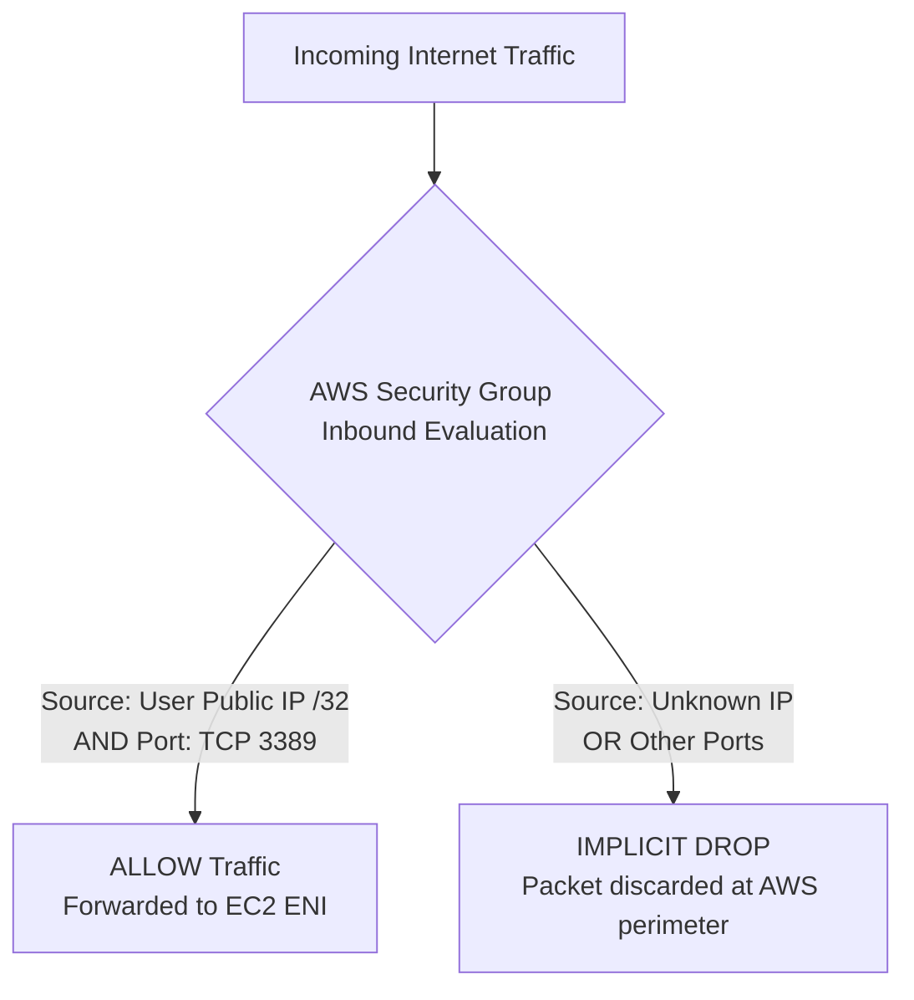

# Cloud Security & Hardening Best Practices

This document outlines defense-in-depth principles, enterprise security architecture patterns, and baseline hardening recommendations for managing cloud-hosted Windows Server workloads on Amazon Web Services (AWS).

---

## 1. The Perils of Exposing Port 3389 to the World (`0.0.0.0/0`)

In cloud network security, configuring a Security Group inbound rule with source `0.0.0.0/0` (Anywhere) opens that specific port to every public IP address on the Internet. 

### Why Exposing RDP to `0.0.0.0/0` is Catastrophic:
1. **Automated Threat Actor Scanners**: Automated Internet scanning engines (such as Shodan, Censys, and criminal botnets) index publicly exposed port 3389 listeners within minutes of provisioning.
2. **Brute-Force & Credential Stuffing**: Once discovered, attackers launch dictionary attacks against known default usernames (such as `Administrator`, `admin`, `guest`) attempting hundreds of password combinations per minute.
3. **Exploitation of Historical & Zero-Day Vulnerabilities**: Legacy and unpatched RDP protocol flaws (such as BlueKeep &mdash; CVE-2019-0708) allow unauthenticated remote code execution at the kernel level without requiring valid credentials.
4. **Primary Ransomware Vector**: According to cybersecurity threat intelligence reports, exposed RDP endpoints represent one of the primary entry vectors for enterprise ransomware deployments.

> [!IMPORTANT]
> **Golden Rule of Network Defense**: Inbound administrative ports (RDP 3389, SSH 22, WinRM 5985/5986) must **NEVER** be opened to `0.0.0.0/0`.

---

## 2. Principle of Least Privilege (PoLP)

The **Principle of Least Privilege** dictates that every module, user, and network connection must be granted only the minimum access necessary to perform its intended operational function.

### Implementing Least Privilege in this Project:
* **Host-Specific CIDR Restrictions**: The Security Group ingress rule is explicitly configured with a single `/32` CIDR block (representing your single local public gateway IP), e.g., `<YOUR_PUBLIC_IP>/32`.
* **Protocol & Port Scope**: Only protocol `TCP` and port `3389` are permitted. All other incoming ports (ICMP ping, HTTP, RPC, SMB) are dropped by default by the AWS stateful firewall.



---

## 3. Local Key Pair Hygiene & Secret Management

The RSA `.pem` private key is the root cryptographic secret required to decrypt the instance's initial `Administrator` password. Mishandling this file compromises server integrity.

### Key Management Guidelines:
1. **Never Commit Secrets to Version Control**:
   * Ensure `.gitignore` explicitly excludes `*.pem`, `*.key`, `*.ppk`, and `.env` files.
   * If a key is accidentally committed to a remote repository, treat it as compromised immediately: terminate the instance and delete the key pair from AWS.
2. **Restrict Local File Permissions (POSIX / Linux / macOS)**:
   Ensure only your user account has read permissions to the key file:
   ```bash
   # Remove group and other permissions; grant read-only access to owner
   chmod 400 ~/.aws/keys/my-ec2-key.pem
   ```
3. **Use Ephemeral Password Storage**:
   * Store decrypted passwords in an encrypted password manager (e.g., 1Password, Bitwarden, KeePassXC).
   * Avoid saving administrative passwords in plaintext text files or desktop sticky notes.

---

## 4. Enterprise Alternatives to Public RDP

While direct RDP restricted by IP is suitable for learning labs and isolated sandboxes, enterprise cloud architectures eliminate public IP exposure entirely through the following patterns:

| Architecture Pattern | How it Works | Security Benefits |
|:---|:---|:---|
| **AWS Systems Manager (SSM) Fleet Manager** | Connects to the Windows desktop directly through the AWS Console using the SSM Agent over outbound HTTPS (Port 443). | **No open inbound ports required.** No public IPv4 address needed on the EC2 instance. |
| **SSM Session Manager Port Forwarding** | Tunnels TCP port 3389 over an encrypted AWS IAM-authenticated WebSocket to the local workstation. | Connect using your local Remmina client pointing to `localhost:<random_port>` without opening any security group ingress. |
| **AWS Client VPN / Direct Connect** | Establishes a private encrypted tunnel between the corporate network and the AWS VPC. | Instances reside exclusively in private subnets with RFC 1918 private IPs (e.g., `10.0.1.50`). |
| **Bastion Host / Jumpbox** | A hardened, minimal Linux/Windows proxy host placed in a public subnet, requiring Multi-Factor Authentication (MFA). | Centralizes and audits administrative access to internal private instances. |

---

## 5. Windows Server Operating System Hardening

Once connected to the Windows instance, apply operating system level hardening:

1. **Enable Network Level Authentication (NLA)**:
   * Enforces user authentication prior to establishing the graphical RDP session, preventing pre-authentication exploit attacks.
   * Verify via: `sysdm.cpl` $\rightarrow$ **Remote** $\rightarrow$ Check *"Allow connections only from computers running Remote Desktop with Network Level Authentication (recommended)"*.
2. **Rename or Disable Default Administrator Account**:
   * Create a named administrative user account and disable or rename the built-in `Administrator` account to blunt brute-force attacks.
3. **Configure Account Lockout Policies**:
   * Set policies via Local Security Policy (`secpol.msc`) to lock accounts for 15-30 minutes after 3-5 failed login attempts.
4. **Automated OS Patching**:
   * Keep the instance updated using **AWS Systems Manager Patch Manager** or Windows Update to apply monthly security patches.

---

## 6. Cloud Cost Governance

Idle cloud instances accrue costs continuously. Maintain proper cloud hygiene:

* **Stop Instances When Inactive**: If you plan to resume the lab later, select **Instance state** $\rightarrow$ **Stop instance**. (Note: Stopped instances incur small EBS storage charges, but compute billing ceases).
* **Terminate Resources When Finished**: When the lab is complete, **Terminate** the instance to release EBS storage volumes and Elastic IPs.
* **AWS Budgets**: Configure zero-spend or $5 budget alerts in AWS Budgets to prevent unexpected cloud charges.

