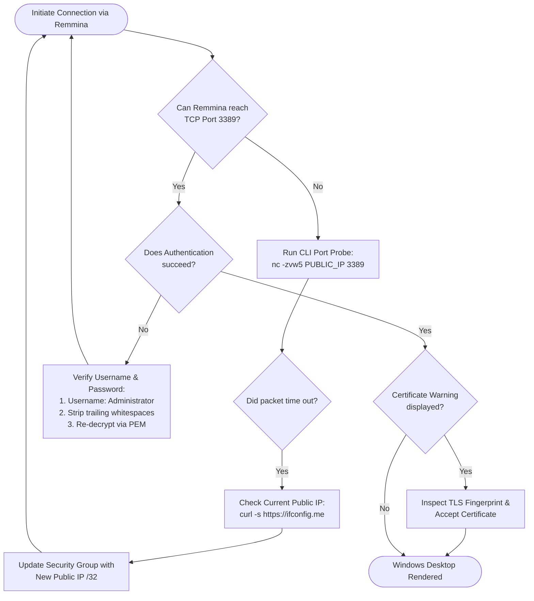

# Troubleshooting Guide & Operational Runbook

This guide provides systematic diagnostic procedures and proven resolutions for common failure modes encountered when connecting from an Ubuntu Linux client to an Amazon EC2 Windows Server instance over Remote Desktop Protocol (RDP).

---

## Diagnostic Flowchart



---

## 1. Network & Port Reachability Issues

### Issue 1: Connection Timed Out (`Connection to RDP server failed`)

#### Root Causes:
1. **Dynamic Public IP Mismatch**: Home and office ISPs frequently rotate dynamic public IPv4 addresses. If your public IP changed after configuring the Security Group, the AWS stateful firewall will silently drop your packets.
2. **Missing Internet Gateway / Subnet Routing**: The instance was launched into a private subnet without an associated Internet Gateway (IGW) or Public IPv4 assignment.
3. **Instance Not in Running State**: The instance is stopped, terminating, or pending.

#### Diagnostic Steps:
1. From your Ubuntu terminal, query your current external IP:
   ```bash
   curl -s https://ifconfig.me
   ```
2. Run a network port probe targeting the EC2 instance on port 3389:
   ```bash
   # Netcat TCP port probe with a 5-second timeout
   nc -zvw5 <WINDOWS_EC2_PUBLIC_IP> 3389
   ```
   * **Expected healthy output**: `Connection to <IP> 3389 port [tcp/ms-wbt-server] succeeded!`
   * **Failure output**: `nc: connect to <IP> port 3389 (tcp) timed out: Operation now in progress`

#### Resolution:
1. In the **AWS Management Console**, navigate to **EC2** $\rightarrow$ **Security Groups**.
2. Select your Security Group (`windows-rdp-restricted-sg`) and choose **Edit inbound rules**.
3. Locate the RDP rule, click the Source dropdown, select **My IP**, or enter `<YOUR_CURRENT_IP>/32`.
4. Click **Save rules**. Rule updates take effect immediately.

---

## 2. Authentication & Credential Issues

### Issue 2: "Password is not available yet" in AWS Console

#### Root Cause:
Windows Server instances execute initial cloud setup routines (Sysprep, `EC2Launch v2`, hardware driver detection) during the first boot. Generating the random administrator password and encrypting it with your RSA public key typically takes between **3 to 5 minutes**.

#### Resolution:
* Do not terminate or reboot the instance.
* Check the **EC2 Dashboard** and wait until **Status check** reports **2/2 checks passed** before clicking **Get password**.

---

### Issue 3: "Invalid Private Key" or Password Decryption Failed

#### Root Cause:
* The `.pem` file selected does not match the key pair name associated with the EC2 instance.
* The `.pem` file content was corrupted, truncated, or converted into an unsupported format (e.g., converted to PuTTY `.ppk` without retaining the OpenSSL `.pem` original).

#### Resolution:
1. In the AWS Console, click your instance and inspect the **Key pair name** property in the Details pane.
2. Verify that the file on your local machine corresponds exactly to that key pair name.
3. If the matching key pair is lost, the instance cannot be decrypted using this method. You must either use **AWS Systems Manager (SSM) Fleet Manager** or terminate and re-launch the instance with an accessible key pair.

---

### Issue 4: Remmina "Authentication Failed" or "CredSSP Error"

#### Root Cause:
1. **Username typographical error**: Windows administrative accounts default to `Administrator` (with a capital `A`).
2. **Whitespace injection**: Copying the password from the AWS decryption dialog may accidentally capture trailing spaces or newline characters.
3. **CredSSP / NLA negotiation mismatch**: Network Level Authentication (NLA) handshake rejection between the client and server.

#### Resolution:
1. Explicitly type `Administrator` into Remmina's username field.
2. Paste the decrypted password into a plain text editor first to ensure no hidden whitespace or carriage return (`\r\n`) characters exist, then copy the clean string.
3. In Remmina:
   * Open connection settings $\rightarrow$ **Advanced** tab.
   * Under **Security**, cycle through `Negotiate`, `NLA`, or `TLS` to establish cryptographic compatibility.

---

## 3. Client Configuration Issues

### Issue 5: Remmina Lacks RDP Protocol Option

#### Root Cause:
Only the base Remmina application was installed without the corresponding `FreeRDP` protocol plugin package.

#### Diagnostic Command:
```bash
dpkg -l | grep remmina-plugin-rdp
```

#### Resolution:
Install the protocol module:
```bash
sudo apt update
sudo apt install -y remmina-plugin-rdp
```
Restart Remmina completely.

---

## 4. Performance & Display Optimization

### Issue 6: Input Latency, Stuttering, or High Bandwidth Usage

#### Root Cause:
High default color depths (32-bit true color) and visual desktop effects (animations, wallpapers, window dragging) strain network throughput over wide-area network (WAN) links.

#### Resolution:
1. In Remmina, edit the connection profile.
2. Under the **Basic** tab:
   * Set **Color depth** to **High color (16 bpp)**.
3. Under the **Advanced** tab:
   * Set **Quality** to **Poor (fastest)** to automatically suppress wallpaper and window animation streaming.

