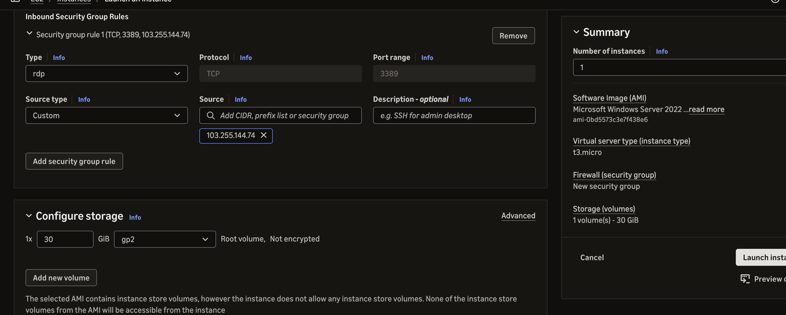
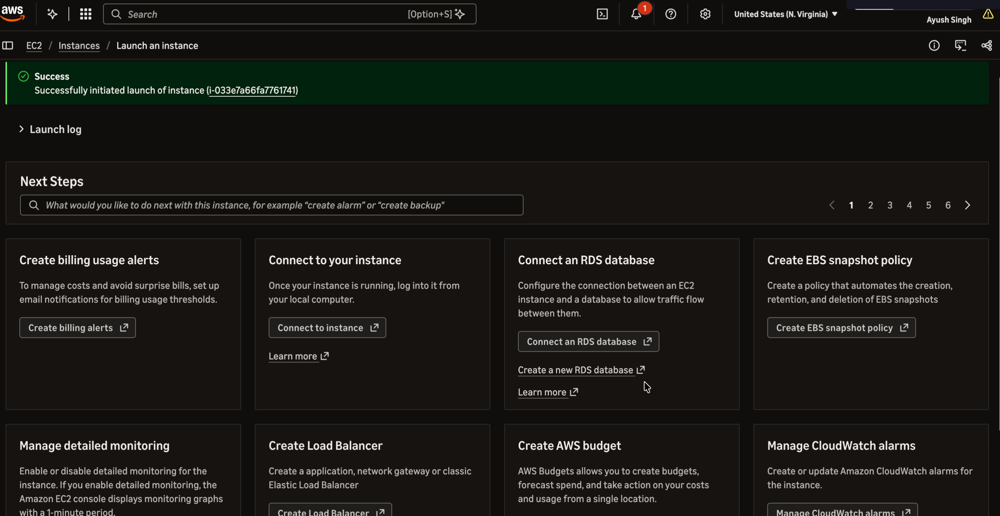
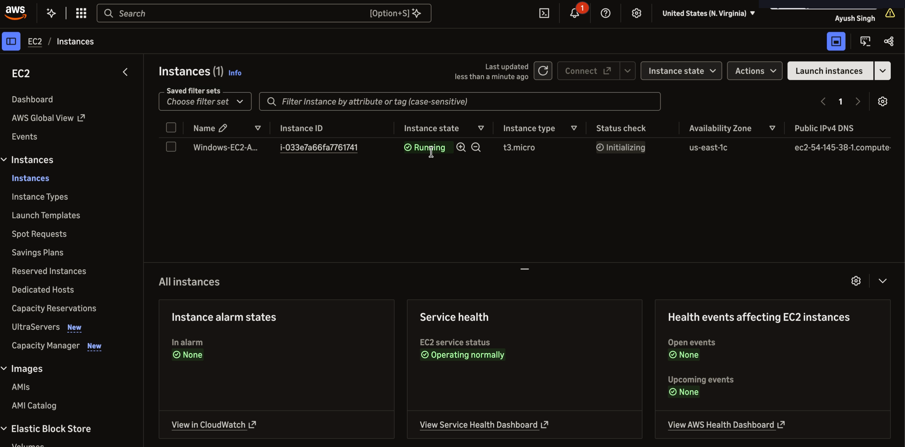
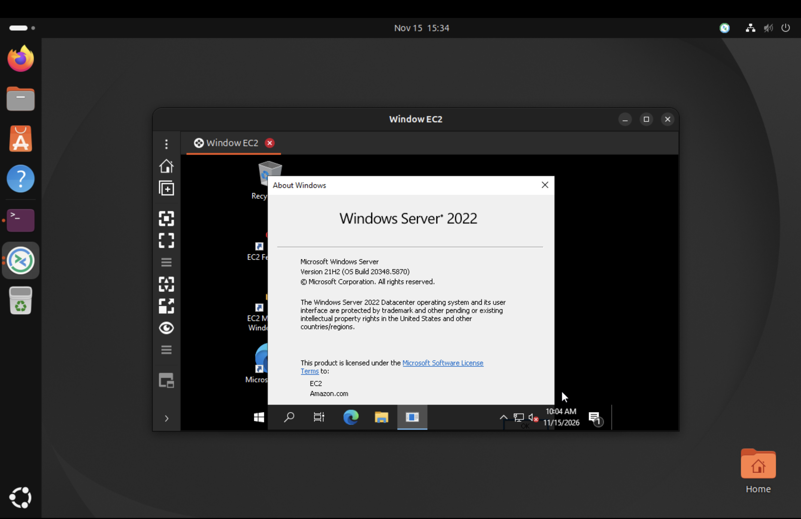

# Lab Evidence & Visual Verification

This directory contains real-world visual verification captures from the hands-on deployment of the **Windows EC2 Deployment & Linux-to-Windows RDP Connection** project.

---

## Verified Lab Screenshots

### 1. Inbound Security Group Hardening
Shows the stateful firewall configuration allowing incoming RDP (TCP port 3389) restricted exclusively to the administrator's public IP address.

---

### 2. EC2 Instance Launch Initialization
Confirmation banner in AWS Management Console verifying the successful provisioning request of the Windows Server instance (`t3.micro`).

---

### 3. EC2 Instance in Running State
AWS EC2 Management Console verifying the provisioned Windows Server instance in **Running** state within the availability zone.

---

### 4. Cross-Platform RDP Session Verified (Ubuntu Linux to Windows Server)
Active Remmina remote desktop session running on the Ubuntu Linux desktop, rendering the **Windows Server 2022 Datacenter** environment (`winver` dialog verifying license to `EC2 Amazon.com`).

